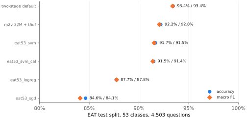

# Classification Benchmarks

All EAT benchmarks use a 15% held-out stratified test split (`random_state=42`). Sentence-type and yes/no benchmarks are evaluated on the full labelled datasets.

## EAT question-type classification (EN)

### Two-stage default (eat7_svm_cal → eat53_svm_cal)

| Metric | Score |
|--------|-------|
| Accuracy | **93.4%** |
| Macro F1 | **93.4%** |

### All baselines

<picture>
  <source media="(prefers-color-scheme: dark)" srcset="img/eat-models-dark.svg">
  
</picture>

`img/plot_eat_models.py` makes this figure from `train/reports/eat/*_benchmark.json`.

| Model | Classes | Accuracy | Macro F1 |
|-------|---------|----------|----------|
| **Two-stage default** | 53 | **93.4%** | **93.4%** |
| `m2v-potion-base-32M+tfidf` | 53 | 92.2% | 92.0% |
| `eat53_svm` (uncalibrated) | 53 | 91.7% | 91.5% |
| `eat53_svm_cal` (calibrated SVM) | 53 | 91.5% | 91.4% |
| `eat53_logreg` | 53 | 87.7% | 87.8% |
| `eat53_sgd` | 53 | 84.6% | 84.1% |
| `eat7_svm_cal` (calibrated SVM) | 7 | 95.6% | 92.9% |

The values come from the committed `train/reports/eat/*_benchmark.json` files.

Plots saved to `train/reports/eat/`.

## Sentence-type classification

6 classes: `command`, `exclamation`, `polar_question`, `request`, `statement`, `wh_question`.

| Language | Accuracy | Macro F1 |
|----------|----------|----------|
| EN | 99.2% | 99.2% |
| FR | 97.1% | 97.1% |
| IT | 97.0% | 97.0% |
| NL | 98.8% | 98.8% |
| PT | 95.4% | 95.4% |
| DE | 85.6% | 84.9% |
| ES | 74.6% | 72.7% |

Plots saved to `train/reports/sentence_type/`.

## Yes/no answer-polarity classification

3 classes: `yes`, `no`, `maybe`.

| Model | Coverage | Accuracy | Macro F1 |
|-------|----------|----------|----------|
| `yesno_svm_cal_{LANG}` (per-language) | 43 languages | ~91-96% | ~91-96% |
| `yesno_svm_cal_multilingual` (bundled) | all languages | 84.6% | 84.0% |

The bundled multilingual model is used when no language-specific model is available. Per-language models achieve 90-96% macro F1 on their own language.

Plots saved to `train/reports/yesno/`.

## Running all benchmarks

```bash
pip install little-questions[train]
python -m train.benchmark_eat
python -m train.benchmark_sentence_type
python -m train.benchmark_yesno
```

---
[← Models](models.md) · [Home](index.md) · [Contributing →](contributing.md)
