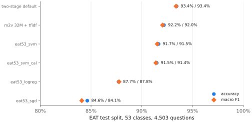

# little_questions
<!-- agent-hint: verify with `pytest -q test/test_docs.py`; the figure and its alt text come from train/reports/eat/. -->

little_questions tells a program what kind of sentence it has: a question and its expected answer type, a command, a request, a statement or an exclamation, and the polarity of an answer. The English models and the multilingual polarity model are in the package, so the library runs offline.

<picture>
  <source media="(prefers-color-scheme: dark)" srcset="img/eat-models-dark.svg">
  
</picture>

[Classification](classification.md) gives every value of this figure.

## Quick start

```python
from little_questions import Sentence
# A question
s = Sentence("Who invented the telephone?")
print(type(s).__name__)          # Question
print(s.sentence_type)           # question
print(s.classification)          # HUM:ind
print(s.main_label)              # HUM
print(s.secondary_label)         # ind
print(s.pretty_label)            # individual (Human)
print(f"{s.confidence:.2f}")     # 0.88
# A command
s = Sentence("Play some jazz music.")
print(type(s).__name__)          # Command
print(s.sentence_type)           # command
# A statement
s = Sentence("The sky is blue.")
print(type(s).__name__)          # Statement
print(s.sentence_type)           # statement
```

[Usage](usage.md) gives the sentence types, the 53 answer types and the polarity classes.

## Project layout

```
little_questions/
├── __init__.py      # Sentence, subclasses, get_classifier(), get_scorer(), get_yesno_classifier()
├── classifiers.py   # EatClassifier, SentenceTypeClassifier, YesNoClassifier, _OnnxModel
├── constants.py     # EAT_LABELS_7, EAT_LABELS_53, SENTENCE_TYPES, MAIN_LABEL_NAMES, SEC_LABEL_NAMES
└── models.py        # HF auto-download helpers
train/               # Training only. Install with pip install little-questions[train]
├── classifiers.py       # CalibratedLinearSVCClassifier, LinearSVCClassifier, LogRegClassifier, SGDClassifier, Model2VecClassifier
├── load_eat.py          # EAT dataset loader
├── load_yesno.py        # Yes/no dataset loader
├── train_eat.py         # Train EAT classifiers → ONNX
├── train_eat_m2v.py     # Train Model2Vec EAT variants
├── train_yesno.py       # Train yes/no polarity classifiers → ONNX
├── train_sentence_type.py
├── benchmark_eat.py     # Full EAT benchmark + plots
├── metrics.py           # EvalResult, evaluate(), compare()
├── mlflow_config.py     # MLflow setup
└── push_to_hf.py        # Push models to HuggingFace
```

## Pages

| Page | Contents |
| --- | --- |
| [Usage](usage.md) | Sentence types, answer types, polarity, other languages, text with no punctuation |
| [API](api.md) | Classes, attributes and functions |
| [Models](models.md) | Model files, where they load from, training |
| [Classification](classification.md) | Benchmark results for each classifier |
| [Contributing](contributing.md) | Development setup and tests |
